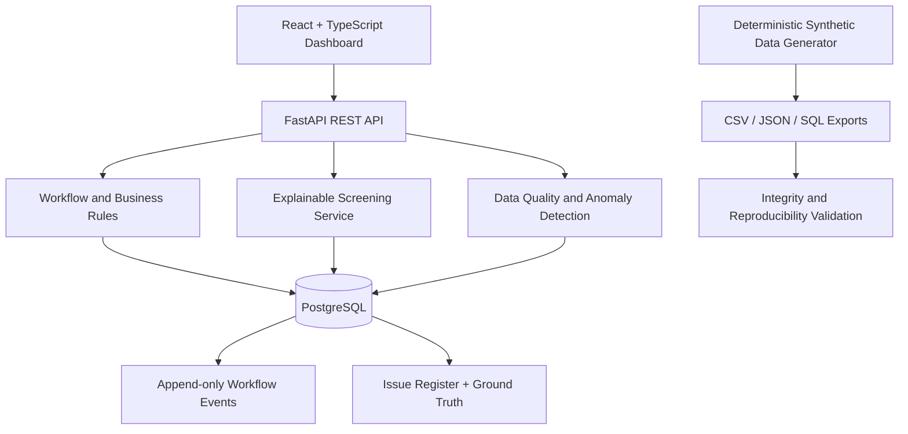

# Architecture

## Responsibilities

- **Frontend:** operational views, funnel metrics, application register and exception register.
- **API:** validated access to business entities and decisions.
- **Workflow services:** permitted lifecycle transitions and immutable event records.
- **Screening service:** weighted job-skill and experience scoring with a reason breakdown.
- **Anomaly service:** identifies interviewer availability/conflicts, missing feedback progression, salary-band violations and active applications on closed roles.
- **Generator:** seeded synthetic data creation with deterministic identifiers.
- **Validation:** key uniqueness, foreign-key checks, row counts and repeatability.

## Entity cardinality

- Department 1:N JobRequisition; Department 1:N Interviewer.
- Interviewer 1:N InterviewerAvailability windows; scheduling requires an available window containing the requested time.
- JobRequisition 1:N Application; Candidate 1:N Application. Application is the associative entity between Candidate and JobRequisition.
- Candidate 1:1 ResumeArtifact.
- Candidate N:M Skill through CandidateSkill.
- JobRequisition N:M Skill through RequisitionSkill.
- JobRequisition 1:1 ScreeningRule (one active rule per requisition in the baseline design).
- Application 1:N Interview; Interviewer 1:N Interview.
- Interview 1:N Feedback (supports panel feedback); Interviewer 1:N Feedback.
- Application 0:1 Offer.
- Any workflow entity 1:N WorkflowEvent; detected entities 1:N Issue over time.

Effective dates are represented by `created_at`, `applied_at`, `scheduled_at` and `detected_at` in the starter implementation. A production extension should add explicit `effective_from` / `effective_to` fields to requisition requirements and screening rules.
